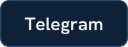
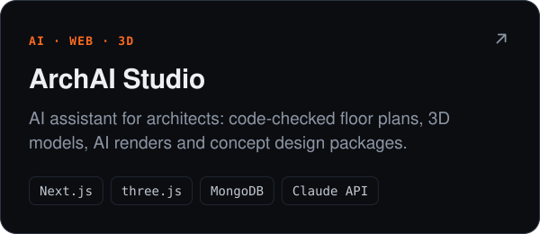
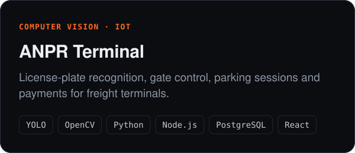
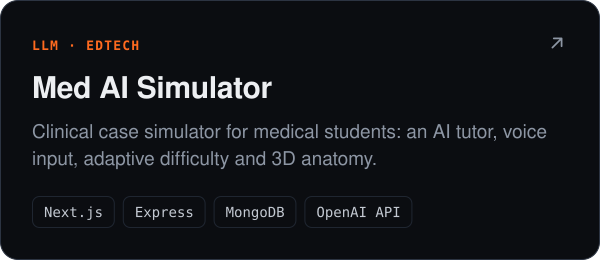
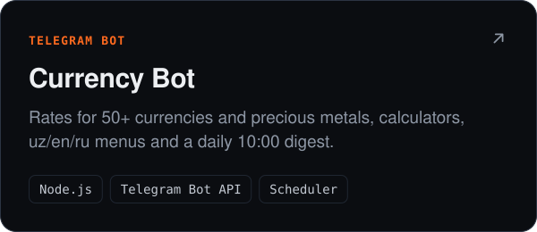
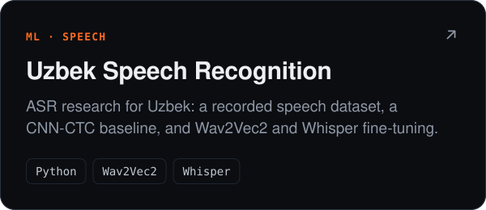
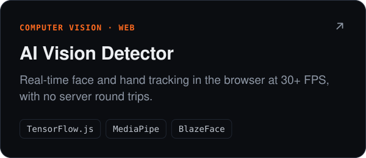
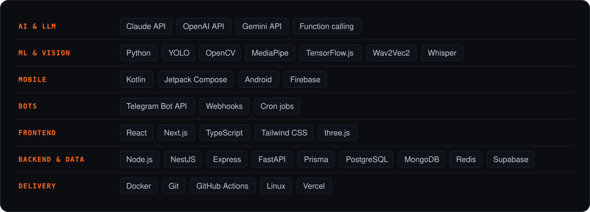
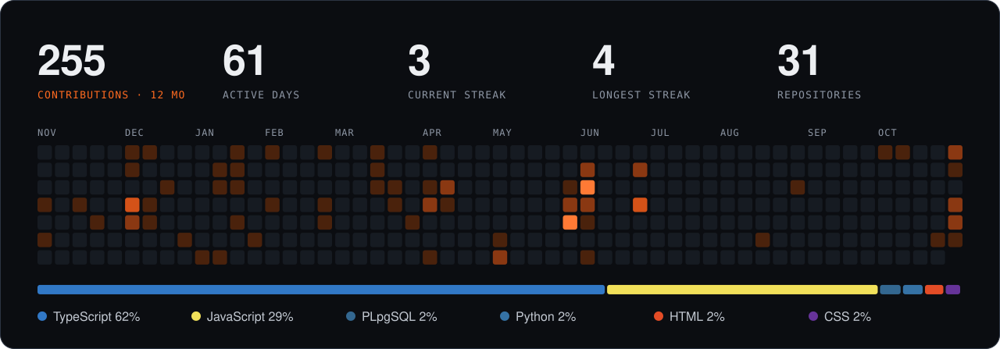

 

  &nbsp;
  &nbsp;
  

I build complete products: web apps, Android apps, Telegram bots and the AI behind them, from the model and the API to the screen people use. I work in Uzbek, Russian and English. **Open to full-stack, mobile and AI engineering roles in Tashkent.**

## What I build

## Selected work

  
  

  
  

  
  

Also built: [CyberSafe](https://github.com/Anvar4/CyberSafe), [IT Arena](https://github.com/Anvar4/GAMIFIKATSIYA), [AeroAI airport system](https://github.com/Anvar4/Airport-ai-system-demo), [YT Downloader Pro](https://github.com/Anvar4/yt_video_downloader_plugin), [AI Chatbot](https://github.com/Anvar4/chatbot-backend).

## Stack

**Now exploring:** system design for scale, AI agents wired into real tools and APIs, real-time recognition, and modern Android with Compose.

## Activity

Computer Science and Programming Technologies student at Termiz State University. Artwork is generated by <code>scripts/build_assets.py</code>; the activity panel is redrawn every day by a GitHub Action.
