  

  &nbsp;
  &nbsp;
  

I build AI products end to end: the model integration, the backend and the interface. **Open to full-stack and AI engineering roles in Tashkent.**

- **AI engineering:** LLM assistants with rate limits and fallbacks, adaptive learning logic, plate recognition and in-browser vision models.
- **Full-stack:** Next.js and React with Node.js or FastAPI, plus auth, payments, CI, Docker deploys and automated tests.
- **UI/UX:** token-based design systems, dark and light themes, and responsive QA at 375 and 1440 px.

## GitHub activity

## Projects

<table>
  <tr>
    <td width="50%" valign="top">
      <b><a href="https://archai.uz">ArchAI Studio</a></b> 
      AI assistant for architects: code-checked plans, 3D, AI renders and concept design packages.  
      Next.js, React, three.js, MongoDB, Claude API
    </td>
    <td width="50%" valign="top">
      <b>ANPR Terminal</b> 
      Plate recognition, gate control, parking sessions and payments for freight terminals.  
      FastAPI, OpenCV, PostgreSQL, React
    </td>
  </tr>
  <tr>
    <td valign="top">
      <b><a href="https://github.com/Anvar4/Med_AI_Simulator">Med AI Simulator</a></b> 
      Clinical case simulation with an AI assistant, voice input and adaptive difficulty.  
      Next.js, Express, MongoDB, OpenAI API
    </td>
    <td valign="top">
      <b><a href="https://github.com/Anvar4/CyberSafe">CyberSafe</a></b> 
      Multi-language cybersecurity learning with video lessons, tests and digital materials.  
      React, TypeScript, Firebase
    </td>
  </tr>
</table>

Also built: [IT Arena](https://github.com/Anvar4/GAMIFIKATSIYA), [AI Vision Detector](https://github.com/Anvar4/al_detector_face_app), [YT Downloader Pro](https://github.com/Anvar4/yt_video_downloader_plugin), [AI Chatbot](https://github.com/Anvar4/chatbot-backend).

## Tech stack

**AI and vision** 

**Interface** 

**Backend and data** 

**Mobile and delivery** 

Computer Science and Programming Technologies student at Termiz State University. Uzbek, Russian (B2), English (B1).
